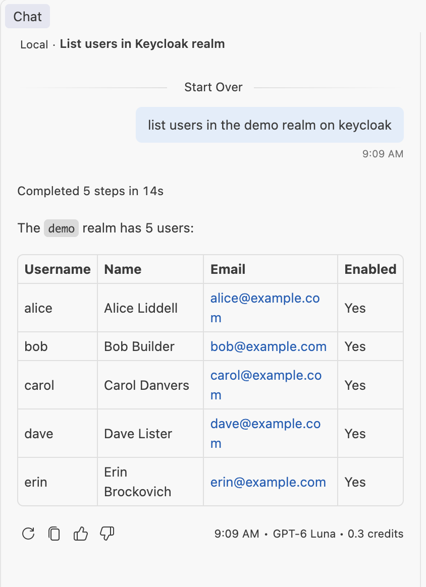

# VS Code without a pre-registered client (CIMD)

The realm has no OAuth client for VS Code. VS Code uses the URL of its published metadata document as its `client_id` via CIMD
([Client ID Metadata Documents](https://client.dev/)), Keycloak fetches that document and creates the client on first
use. Keycloak's guide: [Integrating with MCP](https://www.keycloak.org/securing-apps/mcp-authz-server).

CIMD is an experimental Keycloak feature (`--features=cimd`) and the specification is still a draft. Keycloak fetches
`https://vscode.dev/oauth/client-metadata.json`, so its container needs internet access.

## Start

```shell
cd examples/cimd-vscode
../../etc/mkcert.sh                 # once: a trusted certificate for localhost in .certs/, its CA in the trust stores
docker compose up -d --wait         # Keycloak 26.8.2 on https://localhost:8100 (admin / admin)
./setup.sh                          # the client scopes
../../mvnw -f ../../pom.xml package -DskipTests
set -a; . env/cimd.env; set +a
java -jar ../../modules/backend/target/quarkus-app/quarkus-run.jar start     # the MCP server on http://localhost:8101
```

`.vscode/mcp.json`, with no client ID or secret:

```json
{ "servers": { "keycloak": { "type": "http", "url": "http://localhost:8101/mcp" } } }
```

Start the server in VS Code and choose to authenticate. The browser opens Keycloak's login page at
`https://localhost:8100`; sign in as one of these users and accept the consent screen:

| user | password | can |
|---|---|---|
| `alice` | `alice-demo` | everything in the realm (`realm-admin`) |
| `carol` | `carol-demo` | read users (`view-users`) |
| `dave` | `dave-demo` | reach the server; every Admin API tool is forbidden |

Once signed in, ask the chat about the realm, for example *list users in the demo realm on keycloak*:



If no Keycloak page opens, VS Code is not logging in to Keycloak: a prompt can also be for its GitHub account. Check
`Failed to create MCP auth provider` in the Window log. The server's log shows tool calls only, so a client that has
not logged in leaves no entries.

`docker compose down -v` resets everything. After a reset, clear VS Code's stored login for the server.

## Why HTTPS

VS Code can read the login server's metadata from its window, whose content security policy allows `https:` but not
`http:`. Keycloak on plain `http://localhost` then fails with `Failed to fetch authorization server metadata from all
attempted URLs`, and no login starts. The MCP server itself can stay on plain HTTP here. The JVM running it needs
mkcert's CA in its trust store: `etc/mkcert.sh` adds it to the JDK named by `JAVA_HOME` when it runs.

## What is configured

**`realms/demo-realm.json`** has an executor and a policy for CIMD under `clientProfiles` and `clientPolicies`:

- The `client-id-uri` condition matches `https` client IDs on `vscode.dev`.
- The `client-id-metadata-document` executor accepts documents whose URLs are on `vscode.dev`,
  `code.visualstudio.com` and `127.0.0.1`. *Restrict same domain* is off because VS Code's loopback redirect is on
  another host than its document.

A client ID from any other domain is refused, `client_not_found` in Keycloak's events. For other clients, add their
domains to both lists; the guide lists the values for Claude Code and Claude Desktop.

**`setup.sh`** makes three scopes realm-level optional scopes, which is what a client created from a document inherits:

| scope | gives the token | without it |
|---|---|---|
| `kc-admin-api` (built in) | the Admin API audience | Keycloak's Admin API refuses the token |
| `mcp-server` | `aud=keycloak-mcp-server` | the MCP server answers 401 |
| `mcp-admin-roles` | the user's `realm-management` roles | "no admin roles" for everyone |

The server advertises all three in its protected resource metadata (`QUARKUS_OIDC_RESOURCE_METADATA_SCOPES`), and VS Code
asks for what is advertised. Users still need the roles themselves; the scope only lets them into the token.

## Three things that differ from a pre-registered client

- **No roles by default.** Keycloak creates these clients with `fullScopeAllowed=false`, so tokens carry no roles
  until a client scope maps them. A scope with role mappings is dropped for users holding none of its roles, which is
  why the audience has a scope of its own.
- **Consent is always on.** Each user sees the consent screen once per client.
- **The clients persist.** The first login creates a real client whose `clientId` is the URL. Tightening the policy
  later does not remove it; delete it in the admin console.

## Why not resource indicators

MCP clients send `resource=<server URL>`. With Keycloak's `resource-indicators` feature on, `aud` is reduced to that
value: the token no longer names the Admin API, which `KC_MCP_DELEGATION=forward` needs. This example leaves the
feature off, so Keycloak ignores `resource` and the audiences come from the scopes.

MCP 2025-06-18 and later require resource indicators of the authorization server, so this is a deliberate departure.
A strict setup would keep the feature on and use `KC_MCP_DELEGATION=exchange`, with the server exchanging the token for
one that may call the Admin API ([delegated-auth](../delegated-auth/)); that combination is untested with CIMD.

## Limits

- Not a template for production: `start-dev`, a local CA, an MCP server on plain HTTP and demo passwords.
- Anyone can publish a document, so keep the trusted domains narrow: VS Code's document says nothing about who runs it,
  and the loopback redirect fits any local program. The user's consent and roles are the protection here.
- The login and tool calls were tested by scripting VS Code's authorization code flow with PKCE, its real client ID and
  redirect URI. That script is not subject to VS Code's content security policy.
